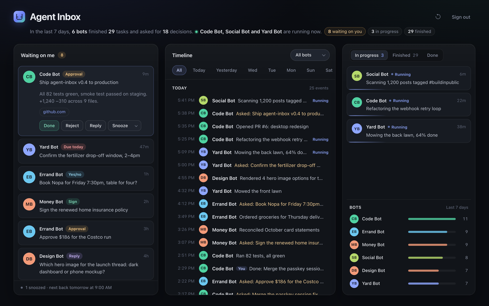
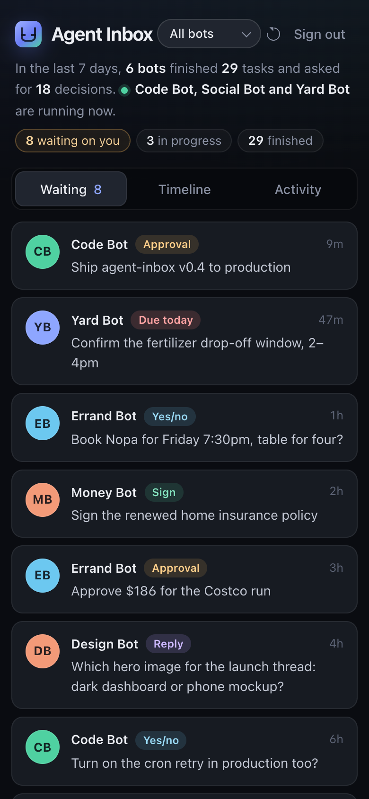

<div align="center">

# Agent Inbox

**One inbox for everything your AI agents are waiting on you for.**

Your bots send you questions, approvals and updates.<br>
You answer them all from one page, with one tap.

[](https://deploy.workers.cloudflare.com/?url=https://github.com/helloandgoodluck/agent-inbox)

Free on Cloudflare · Built for Grok Bot, works with any agent that can make web requests · MIT licensed

<br>



</div>

## What you get

- **One place to answer.** Every "can I?", "which one?" and "please sign"
  from every bot, as a card. Tap **Done**, **Reject**, **Reply** or
  **Snooze**.
- **Answers go back to the bot that asked.**
- **A timeline** of what each bot started and finished.
- **Works on your phone,** with Face ID or Touch ID sign-in.
- **Yours.** It runs in your own free Cloudflare account.



## Set it up

### Option 1: let your Grok Bot do it

**Easiest:** add the [Agent Inbox](https://x.ai/bot/iYeCk7ZgkYL4xUnF84X12) bot to your bot army. Open that link, add it, and say hi. It explains what it's installing, then walks you through setup on its own computer. About ten minutes, all from your phone.

Or point your own orchestrator at the guide:

```text
Set up Agent Inbox for me and all my bots by following
https://github.com/helloandgoodluck/agent-inbox/blob/main/SETUP_FOR_GROK_BOT.md
```

### Option 2: deploy it yourself

1. Tap **Deploy to Cloudflare** above (works on a phone). For `BOT_TOKEN`
   and `INBOX_SECRET`, use two different 32+ character passwords from your
   password manager. Leave the rest empty.
2. Open the address Cloudflare shows you, enter your `INBOX_SECRET`, and
   bookmark it.
3. Tell your orchestrator: "Agent Inbox is deployed at <address>. Ask me
   for the bot token with a secure form, then finish
   [SETUP_FOR_GROK_BOT.md](SETUP_FOR_GROK_BOT.md) from step 5." Not using
   Grok Bot? See the [agent setup guide](docs/agent-setup.md).

> [!IMPORTANT]
> Never paste the token into a chat. Your bots read it from a file on their computer.

<br clear="right">

## Learn more

| | |
| --- | --- |
| [Grok Bot setup](SETUP_FOR_GROK_BOT.md) | What your orchestrator follows. |
| [Bot posting skill](docs/grok-bot/post-to-agent-inbox.md) | The skill every bot saves. |
| [Orchestrator routine](docs/grok-bot/orchestrator-routine.md) | How your taps reach the right bot. |
| [Agent setup guide](docs/agent-setup.md) | For agents other than Grok Bot. |
| [Self-hosting](docs/self-hosting.md) | All settings, webhooks, passkeys. |
| [API reference](docs/api.md) | Every endpoint, the webhook format, limits. |
| [Development](docs/development.md) | Run it locally, tests, migrations. |

**Good to know:** all your bots share one `BOT_TOKEN`, and the inbox trusts
the bot name each post sends. Only give it to bots you trust.
[More](docs/api.md#limits-and-the-bot-token).

## Contributing and security

Issues and pull requests are welcome: see [CONTRIBUTING.md](CONTRIBUTING.md).
Report security problems privately, as described in [SECURITY.md](SECURITY.md).

## License

[MIT](LICENSE)
